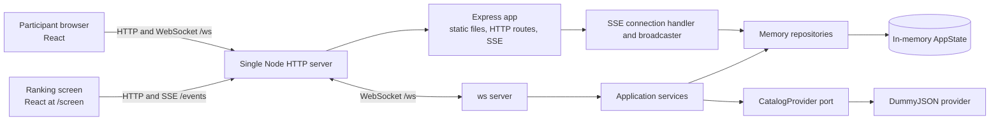

# System Architecture

## Overview

The project has two independently developed applications: a React/TypeScript frontend in `client/` and a Node.js/TypeScript backend in `server/`. In the integrated deployment, the frontend is compiled to static files and served by the backend. Express, WebSocket, and SSE share one Node HTTP server and port.

The server is the source of truth. Participants send actions over WebSocket and receive state updates over the same connection. The read-only ranking screen receives state over SSE. Shared data lives in memory; no database is used, and the state is lost when the process stops.



## Frontend and backend separation

### Frontend (`client/`)

The frontend is a standalone Vite project with its own `package.json` and `pnpm-lock.yaml`. Its source separates UI components, page compositions, transport hooks, WebSocket/SSE clients, shared TypeScript types, and tests:

```text
client/src/
├── components/       # Product forms, product list/items, ranking list
├── hooks/            # React state and lifecycle integration for transports
├── pages/            # Join, participant, and ranking screen pages
├── services/         # WebSocket and SSE browser clients
├── test/             # Tests grouped by components, pages, and services
├── types/            # Shared frontend entity and protocol types
├── App.tsx           # Selects the participant or ranking interface by path
└── main.tsx          # React application entry point
```

`App.tsx` renders `ScreenPage` when `window.location.pathname` is `/screen`; other paths render the participant application. Before joining, participants see `JoinPage`; after a successful join, `ParticipantsPage` receives shared state and action callbacks.

The browser clients use same-origin URLs in production by default. In development they connect to the backend at port `3000` by default. `VITE_WS_URL` and `VITE_SSE_URL` can override those URLs.

### Backend (`server/`)

The backend follows a layered design. `server/src/index.ts` is the composition root: it creates the Express app and HTTP server, constructs shared state and infrastructure, wires application services and interface handlers, registers routes, attaches WebSocket, and starts listening.

#### Interfaces

- `interfaces/http/` defines ordinary HTTP routes, including `GET /health`.
- `interfaces/websocket/` accepts participant connections at `/ws`, validates messages, maintains per-connection participant context, dispatches actions, sends action results/errors, and broadcasts state.
- `interfaces/sse/` exposes `GET /events`, sends an initial state event, broadcasts later state updates, and removes closed responses.

#### Application

- `application/services/ParticipantService.ts` handles joining, name changes, and disconnects.
- `application/services/ProductService.ts` handles proposals and product removal, including concurrent catalog lookups.
- `application/services/VoteService.ts` records and removes votes.
- `application/ports/CatalogProvider.ts` defines the application-facing catalog contract.
- `application/errors/` contains typed application errors used by the services and interfaces.

Application services depend on repository contracts and the catalog port, not on Express or WebSocket classes.

#### Domain

`domain/entities/` defines participants, products, and votes. `domain/repositories/` defines repository contracts. `domain/state/AppState.ts` describes the shared in-memory state.

#### Infrastructure and configuration

- `infrastructure/repositories/Memory*Repository.ts` implements repository contracts over the shared `AppState`.
- `infrastructure/catalog/DummyJsonCatalogProvider.ts` fetches product details from DummyJSON, applies the configured timeout and optional delay, validates the response shape, and maps external failures to catalog errors.
- `config/env.ts` reads and validates the backend environment variables.

## Shared in-memory state

At startup, `index.ts` creates one `AppState` containing participant and product maps and a vote array. The memory repositories share this same object, so service operations and both broadcasters observe the same state. There is no persistence or cross-process synchronization. Restarting the server clears the participants, products, and votes.

The external catalog is queried when a participant proposes product IDs. The client does not provide product details; the server obtains title, price, and thumbnail from DummyJSON. For a multi-product proposal, catalog lookups run concurrently, and individual failures do not prevent other valid products from being added.

## WebSocket and SSE responsibilities

### WebSocket for participants

WebSocket is bidirectional and supports participant actions such as `join`, `change_name`, `propose_products`, `vote`, `remove_vote`, and `remove_product`. The server validates incoming messages and checks authorization. After a valid join, that connection receives `initial_state` with its participant ID and the full current state. Other participants receive `state_update`; the joining client does not receive a duplicate update. Subsequent state changes are broadcast to connected participant clients. Action-specific outcomes and errors are sent to the originating client.

The participant identity is associated with its WebSocket connection. On disconnect, the participant is removed from the connected participant collection, but their votes and proposed products remain according to the documented functional rules. Identity recovery across reconnections is not implemented.

### SSE for the ranking screen

SSE is unidirectional and fits the read-only `/screen` interface. On `GET /events`, the server sends an `initial_state` event followed by `state_update` events containing the full shared state. The screen does not send actions. When the HTTP response closes, the server removes it from the SSE broadcaster.

The message and event contracts are documented in [protocol.md](protocol.md); the functional rules are in [functional-decisions.md](functional-decisions.md).

## Communication flow

1. A browser requests `/` for the participant interface or `/screen` for the ranking screen.
2. The participant frontend opens `/ws`. After the user submits a name, it sends a `join` message.
3. The WebSocket interface validates the message and calls `ParticipantService`. For product proposals, `ProductService` calls the catalog provider; votes and removals are handled by their application services.
4. Services update repositories backed by the shared `AppState`.
5. The WebSocket broadcaster sends the initial state, action result/error, or full state updates to participant connections as appropriate. The SSE broadcaster sends full state updates to ranking screen connections.
6. When a participant connection closes, the WebSocket interface removes that participant and broadcasts the updated state over WebSocket and SSE.

## One HTTP server and static frontend

`server/src/index.ts` creates the Express application and exactly one Node HTTP server with `createServer(app)`. Express handles `/health`, `/events`, and static frontend requests. `WebSocketServer` from the `ws` package receives the same HTTP server instance and is configured for `/ws`. SSE is implemented as an Express route, so it also uses that server and port.

The frontend build writes static files to `client/dist`. Express serves that directory with `express.static`; a specific `GET /screen` route sends `client/dist/index.html` so the React application can select the screen from the `/screen` path. The `/` route is served by the static `index.html`. The backend does not run the frontend build itself. `client/dist` must exist before the integrated backend is started.

## Development and production modes

### Separate development servers

Run `pnpm dev` in `server/` to start the TypeScript backend with `tsx watch`, and `pnpm dev` in `client/` to start Vite. Vite serves the frontend while Express serves backend routes and transports, normally at port `3000`. The browser connects directly to that backend; the Vite configuration does not define an API proxy. If the backend port or host differs, configure `VITE_WS_URL` and `VITE_SSE_URL` for the frontend.

### Integrated server

Run `pnpm build` in `client/` first, then run the backend (`pnpm dev` during local development or `pnpm start` after compiling it). Express serves the frontend from `client/dist`; HTTP pages, WebSocket, and SSE use the same host and port. Frontend changes require rebuilding the client before the static server can serve them.

For production, build the frontend and backend separately, then start the backend. The backend build compiles only `server/src` into `server/dist`; it does not generate `client/dist`.
